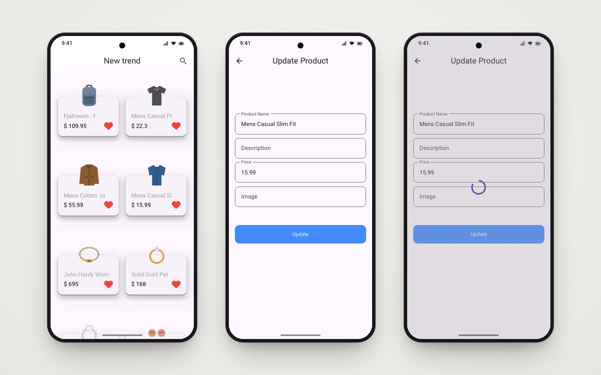

<h1 align="center">Shop App</h1>

<p align="center">A product catalogue for a store, built on the Fake Store REST API, with an edit-product flow.</p>

<p align="center">
  
  
  
  
</p>

<p align="center">
  
  <br/><sub>Home · Update product · Saving</sub>
</p>

## About

A store app built while learning **REST APIs in Flutter** with the `http` package against [Fake Store API](https://fakestoreapi.com/). The home screen shows a two-column grid of product cards with the image floating above each card. Tap a product to open an update form, which sends a `PUT` request to the API. All HTTP calls go through one reusable `Api` helper class with GET, POST and PUT methods.

## ✨ Features

- 🛍️ **Product grid**: products loaded from `/products` with a `FutureBuilder` and a loading spinner.
- 🃏 **Custom product cards**: title, price and a heart icon, with an elevated card and a floating product image.
- ✏️ **Update product**: edit the name, description, price and image URL, then send a `PUT /products/{id}`. A modal progress HUD shows while the request runs.
- 🌐 **Reusable API helper**: `Api.get / post / put` with optional bearer-token headers and status-code checks.
- 🧩 **Service layer** for the other Fake Store endpoints: add product (`POST`), list categories, and products by category.

## 🛠 Tech stack

| Concern | Choice |
|---|---|
| Networking | `http` behind a generic `Api` helper |
| UI | Material, `font_awesome_flutter` icons, `modal_progress_hud_nsn` |
| State | `FutureBuilder` + `StatefulWidget` |
| Navigation | Named routes (`HomePage`, `UpdateProductPage`) |

## 🏗 Project structure

```
lib/
├── helper/      # Api: GET / POST / PUT wrapper
├── models/      # ProductModel, RatingModel
├── screens/     # HomePage, UpdateProductPage
├── services/    # all products, categories, by-category, add, update
├── widgets/     # CustomCard, CustomButton, CustomTextField
└── main.dart
```

## 🚀 Getting started

**Prerequisites:** Flutter SDK (Dart `^3.5.3`). No API key is needed.

```bash
git clone https://github.com/youssef336/shop_app.git
cd shop_app
flutter pub get
flutter run
```

> Fake Store API is a mock backend: write requests (`POST` / `PUT`) return a realistic response, but nothing is saved on the server.

## 👤 Author

**Youssef Belal Zakaria** · [GitHub @youssef336](https://github.com/youssef336)

⭐ If you like this project, give it a star!
